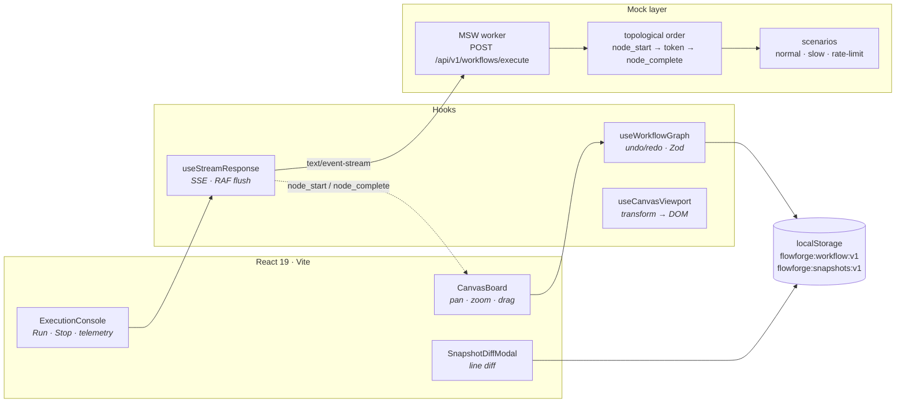

# FlowForge UI

**AI Agent & Prompt Workflow Orchestrator** — build, run and inspect prompt workflows with
live streaming telemetry, fully mocked, fully offline.

A dark, Swiss-Industrial / precision-tooling interface for building, running and
inspecting prompt workflows. Flat surfaces, 1px structural borders, 6px geometry,
monospace telemetry.

---

## Stack

| Concern        | Choice                                                            |
| -------------- | ----------------------------------------------------------------- |
| Framework      | React 19 + Vite + TypeScript (`strict`, `noUncheckedIndexedAccess`) |
| Styling        | Tailwind CSS v4 (`@theme` tokens, no config file)                  |
| Fonts          | Inter (UI) · JetBrains Mono (metrics, IDs, latency) — self-hosted  |
| Primitives     | Radix Dialog, Radix Tabs · `lucide-react` (`strokeWidth={1.5}`)     |
| Docs & tests   | Storybook 10 (`play` interaction tests) + Vitest (jsdom + browser)  |
| Delivery       | Multi-stage Docker + Compose · GitHub Actions CI/CD                |

## Quickstart

```bash
docker compose --profile prod up --build   # app :3000 · Storybook :6006
```

No backend, no API keys, no `.env`: a Mock Service Worker serves the streaming
endpoint from `public/mockServiceWorker.js`, so the production image is standalone.

Local development:

```bash
npm ci
npm run dev            # app        → http://localhost:5173
npm run storybook      # design sys → http://localhost:6006
```

## Architecture



## Engineering highlights

- **Batched streaming.** `useStreamResponse` parses SSE frames with `TextDecoder`,
  buffers tokens in a ref and flushes once per `requestAnimationFrame` — a 200 token/s
  stream re-renders at most 60×/s instead of once per token.
- **Real cancellation.** An `AbortController` per run; starting a run aborts the
  previous one, and unmount aborts silently. Status is a closed union:
  `idle · connecting · streaming · completed · aborted · error`.
- **Measured, not invented, telemetry.** `ttftMs`, `totalLatencyMs`, `tokenCount` and
  `tokensPerSecond` come from `performance.now()` deltas around the actual response.
- **Graph-aware mock.** The worker runs Kahn's topological sort over the posted nodes
  and streams `node_start` / `token` / `node_complete` / `done`, so the canvas lights up
  node by node exactly as a real orchestrator would.
- **Chaos on demand.** A `x-mock-scenario` header switches between `normal`, `slow`
  (1.5 s time-to-first-token) and `rate-limit` (a genuine `429` with `Retry-After`),
  which the console renders as an error state with its HTTP badge.
- **Snapshot diffing.** Named prompt snapshots in `localStorage` plus a dependency-free
  LCS line diff with dual line numbers — the review surface for prompt changes.
- **Contract-first.** One Zod schema validates hydration, import and every fixture; the
  same discriminated union drives the canvas, the inspector and the mock.
- **Tested three ways.** Vitest (jsdom) for hooks and reducers, Storybook `play`
  functions in real Chromium for components, Playwright for the streaming loop
  end-to-end against the production build.

## Scripts

| Script                  | What it does                                                |
| ----------------------- | ----------------------------------------------------------- |
| `npm run dev`           | Vite dev server with HMR                                    |
| `npm run lint`          | ESLint (typescript-eslint type-checked, react-hooks)        |
| `npm run build`         | `tsc --noEmit` then production bundle into `dist/`          |
| `npm run preview`       | Serve the production bundle on `:4173`                      |
| `npm run typecheck`     | Strict TypeScript, no emit                                  |
| `npm run test`          | Vitest unit/component tests (jsdom) + JUnit report          |
| `npm run test:ci`       | Same suite, CI reporter + JUnit output                      |
| `npm run test:stories`  | Storybook `play` interactions in headless Chromium          |
| `npm run test:e2e`      | Playwright E2E against `vite build` + `vite preview`         |
| `npm run test:all`      | All three suites                                            |
| `npm run storybook`     | Storybook dev server                                        |
| `npm run build-storybook` | Static Storybook into `storybook-static/`                 |

## Design system

Tokens live in [`src/design-system/tokens.css`](src/design-system/tokens.css) and are the
single source of truth. Components never hardcode a colour, radius or shadow.

| Token                    | Value                     | Use                                   |
| ------------------------ | ------------------------- | ------------------------------------- |
| `--color-bg-canvas`      | `#0A0A0B`                 | viewport, dot-grid canvas             |
| `--color-bg-panel`       | `#121215`                 | sidebar, inspector, topbar            |
| `--color-bg-elevated`    | `#18181C`                 | node cards, modals, dropdowns         |
| `--color-border-subtle`  | `rgba(255,255,255,.08)`   | structural hairline                   |
| `--color-border-strong`  | `rgba(255,255,255,.16)`   | hover / emphasis hairline             |
| `--color-text-primary`   | `#FAFAFA`                 | primary text                          |
| `--color-text-secondary` | `#A1A1AA`                 | secondary text                        |
| `--color-text-muted`     | `#71717A`                 | labels, telemetry keys                |
| `--color-accent-primary` | `#0070F3`                 | selection, focus ring, primary CTA    |
| `--color-status-success` | `#10B981`                 | `200 OK`, active stream               |
| `--color-status-warning` | `#F59E0B`                 | token-limit warning                   |
| `--color-status-error`   | `#EF4444`                 | `429 Rate Limit`, failed node         |
| `--radius-sm` / `-md`    | `4px` / `6px`             | chips / controls and cards            |
| `--font-sans` / `-mono`  | Inter / JetBrains Mono    | UI / telemetry                        |

Utilities: `bg-dot-grid` (24px dot lattice) and `tnum` (tabular figures).

### Components

`Button` · `Badge` · `Input` · `Modal` · `NodeCard` — each with a story and a `play`
interaction test. Everything is exported from `src/design-system/index.ts`.

```tsx
import { Button, NodeCard } from "./design-system";
```

### Anti-generic rules

Rejected in review: purple/neon gradients, glassmorphism blobs, heavy drop shadows,
oversized radii. Selection and state are expressed with borders and colour tokens.

## Phase 2 — graph engine

### Domain (`src/types/workflow.ts`)

`PromptNode` · `ToolNode` · `EvaluatorNode` form a discriminated union on `type`;
`WorkflowEdge` and `WorkflowState` complete the model. Every payload is validated by
Zod (`workflowSchema`) on hydration and on JSON import — unknown node types,
out-of-range temperature/threshold, duplicate ids, dangling edges and self-loops
are rejected with a `path: message` error.

### Hooks (`src/hooks/`)

| Hook                 | Contract                                                                                     |
| -------------------- | -------------------------------------------------------------------------------------------- |
| `useUndoRedo<T>`     | `useReducer` history (`past/present/future`), `set`/`setTransient`/`commit`, `undo`/`redo`, `canUndo`/`canRedo`, `reset`, `maxHistory` cap, `Ctrl/Cmd+Z`, `Ctrl/Cmd+Shift+Z`, `Ctrl/Cmd+Y` — ignored while an `INPUT`, `TEXTAREA`, `SELECT` or `contentEditable` has focus. |
| `useCanvasViewport`  | Pan/zoom written straight to the DOM (`translate3d … scale`), zoom clamped to `0.4–1.8`, wheel zoom anchored on the cursor, debounced `zoomPercent` readout, `resetViewport()`. |
| `useWorkflowGraph`   | Wraps `useUndoRedo<WorkflowState>`: `addNode`, `updateNodeData`, `moveNodeTransient` (no history), `commitNodeMove` (one entry per drag), `removeNode` (cascades edges), `connectNodes` (rejects self-loops, duplicates and cycles), `removeEdge`, `renameWorkflow`, `replaceWorkflow`; persists to `flowforge:workflow:v1` with a 400 ms debounce. |

### Canvas (`src/features/canvas/`)

- `CanvasBoard` — dot-grid viewport, draggable `NodeCard`s, `<svg>` layer with cubic
  Bezier edges between ports, empty state.
- `CanvasToolbar` — editable workflow title, `+ Prompt` / `+ Tool` / `+ Evaluator`,
  Undo/Redo with live state and `<kbd>` hints, zoom control, Export JSON and Import
  (Zod-validated) modals.
- `NodeInspector` — 320px panel with type-specific controls (model select, temperature
  slider, prompt textarea, tool endpoint/timeout, criteria + pass threshold) and delete.

Only Phase 1 design-system components are used for UI chrome.

## Phase 3 — streaming playground

### `useStreamResponse` (`src/hooks/useStreamResponse.ts`)

| Field / method  | Contract                                                                         |
| --------------- | -------------------------------------------------------------------------------- |
| `status`        | `'idle' \| 'connecting' \| 'streaming' \| 'completed' \| 'aborted' \| 'error'`     |
| `content`       | Accumulated text, flushed once per animation frame                                |
| `metrics`       | `{ ttftMs, totalLatencyMs, tokenCount, tokensPerSecond }`                         |
| `error`         | Human-readable failure (`429 Too Many Requests · retry in 3s`, network, stream)   |
| `httpStatus`    | Last response status, for the `200 OK` / `429` badge                              |
| `executeStream` | `({ url, body, headers, onEvent, onSettled })` — aborts any run in flight          |
| `abort` / `reset` | Cancel mid-stream / return to `idle`                                            |

Pure helpers `parseSseChunk` and `tokenText` are exported for unit testing.

### Mock layer (`src/mocks/`)

- `handlers.ts` — `POST */api/v1/workflows/execute` returning a `ReadableStream` of
  `text/event-stream`. Nodes are executed in topological order; each emits
  `node_start`, one `token` per word (~25 ms) and `node_complete`, then `done`.
- Scenario header `x-mock-scenario`: `normal` · `slow` (1.5 s first-token latency) ·
  `rate-limit` (`429` + `Retry-After: 3`).
- `browser.ts` — `setupWorker` registered from `main.tsx` before the first render;
  failures degrade to a visible network error instead of a blank screen.

### Execution console (`src/features/playground/`)

Run / Stop / Clear, a live network-mode switch, and a telemetry row with TTFT, tok/s,
token count, HTTP badge and status badge. `node_start` frames flip the matching
`NodeCard` to `running`, `node_complete` to `success` — the canvas is the run's
dashboard, not a static drawing.

### Snapshots (`src/features/versioning/`)

`SnapshotDiffModal` saves named prompt snapshots to `flowforge:snapshots:v1` and diffs
any two versions (or a version against the current canvas) line by line, with dual
gutter line numbers and add/remove colouring.

### E2E (`tests/e2e/workflow.spec.ts`)

Five Playwright specs against the production build: worker boot, a full stream that
grows the console and ends `completed` / `200 OK`, mid-stream abort, the `429`
scenario surfacing as an alert, and snapshot save + diff.

## Docker

```bash
docker compose --profile prod up -d --build     # web :3000 · storybook :6006
docker compose --profile dev up web-dev storybook-dev
```

- `docker/Dockerfile.web` — `deps` → `development` → `build` → `runtime` (nginx, non-root, `:8080`, `/healthz`)
- `docker/Dockerfile.storybook` — same shape, serving `storybook-static`
- Both runtime stages run `read_only` with tmpfs mounts and `no-new-privileges`.

## CI / CD

- **`.github/workflows/ci.yml`** — typecheck → unit → Storybook interaction tests →
  builds → Docker build + container smoke test, gated by the `CI success` job.
- **`.github/workflows/cd.yml`** — on `v*.*.*` tags: verify → publish both images to
  GHCR (provenance + SBOM) → Trivy scan → environment-gated deploy → GitHub Release.

Required repository secrets/vars: `DEPLOY_HOOK_URL` (optional), `DEPLOY_URL` (environment URL).

## Structure

```text
src/
├── design-system/
│   ├── tokens.css        # @theme palette, geometry, base layer, utilities
│   ├── index.ts          # public surface of the design system
│   ├── utils/cn.ts
│   └── components/{Button,Badge,Input,Modal,NodeCard}/
├── features/
│   ├── canvas/           # CanvasBoard, CanvasToolbar, NodeInspector, GraphNode, seed
│   ├── playground/       # ExecutionConsole, networkModes
│   └── versioning/       # SnapshotDiffModal, snapshotStore (LCS diff)
├── hooks/                # useUndoRedo, useCanvasViewport, useWorkflowGraph, useStreamResponse
├── mocks/                # handlers (SSE + topological order), browser worker
├── types/workflow.ts     # discriminated union + Zod schema
├── App.tsx
└── main.tsx
tests/e2e/                # Playwright specs
public/mockServiceWorker.js
```
